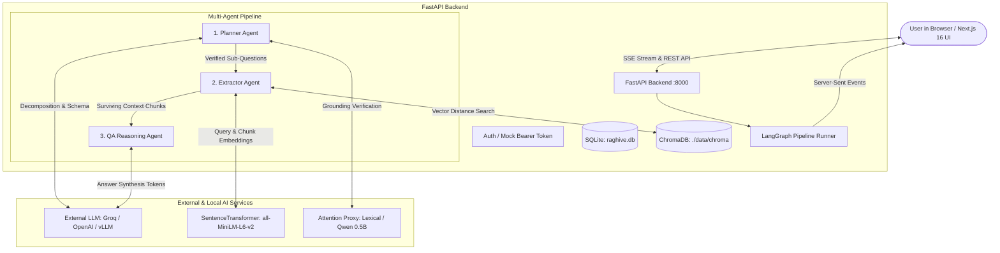

# RAGHive: System Architecture & Technical Implementation Guide

**RAGHive** is a glass-box, explainable, multi-agent Retrieval-Augmented Generation (RAG) platform. Unlike conventional "black-box" RAG systems that retrieve chunks and generate answers invisibly, RAGHive exposes and verifies every step of the decision-making process before and during generation.

---

## 1. Executive Summary & Problems Solved

### What Was Originally Present
The project was designed around a three-agent LangGraph pipeline:
1. **Planner Agent**: Decomposes user questions into sub-questions and verifies plan completeness.
2. **Extractor Agent**: Retrieves documents, applies reranking, and filters evidence using dual-score attribution (`NormEnsembleXAI`).
3. **QA / Reasoning Agent**: Synthesizes surviving chunks, streams the answer, and performs faithfulness and citation attribution.

### Critical Issues Discovered During System Audit
1. **Silent Fallback to SHA-256 Random Hash Embeddings**:
   `sentence-transformers` was commented out in `requirements.txt` under optional extras. On startup, `embeddings.py` caught the missing import and silently fell back to `_hash_embed()`, projecting words into 384-dimensional random buckets using SHA-256 modulo math. All semantic search in ChromaDB was completely broken (semantic similarity between queries and answers was ~0.06 to 0.09).
2. **Context Starvation via Destructive `_minmax` Normalization**:
   `attribution.py` applied a mathematical `_minmax()` across retrieved chunks. This forced the lowest-scoring chunk in any batch to `0.0`, regardless of how good it was. In `extractor.py`, strict thresholds (`sim_threshold=0.52`, `attribution_threshold=0.48`) subsequently discarded almost all chunks. The QA agent frequently received `"(no surviving evidence chunks)"` and returned fallback errors.
3. **Arbitrary Fixed-Character Slicing in Ingest**:
   Documents were chunked at fixed 700-character boundaries without checking for sentences, cutting words, tables, and definitions in half.
4. **External LLM Structured Output Fragility**:
   When using external models (e.g., Groq `llama-3.3-70b-versatile`), LangChain's `with_structured_output` could fail or reject the schema, causing `planner.py` to silently fall back to primitive regex string splitting.
5. **ChromaDB Cache Contamination**:
   The local ChromaDB collection had previously indexed uploaded files using the broken hash embedder, preventing queries from matching correctly.

### Solutions Implemented
- Installed `sentence-transformers`, `torch`, `transformers`, and `scikit-learn` in `.venv`. Configured `all-MiniLM-L6-v2` (384-dim, dense semantic embeddings running on CPU in milliseconds).
- Replaced naive string slicing with a recursive text splitter splitting on paragraphs (`\n\n`), newlines (`\n`), and sentence boundaries (`. `, `? `, `! `).
- Replaced zero-collapsing `_minmax` with calibrated soft scaling (`floor=0.25`), added composite scoring (`0.65 * s_sim + 0.35 * a_ens`), and added a **Top-K Safety Fallback** ensuring candidate evidence is never starved.
- Hardened `planner.py` with a multi-strategy JSON prompt fallback for external LLMs.
- Calibrated lexical faithfulness by removing stop-words so valid paraphrases are not flagged as hallucinations.
- Built [`backend/reindex.py`](file:///d:/hack_/Raghive-frontend/backend/reindex.py), wiped the outdated hash collection, and re-embedded all 146 document chunks with neural vectors (similarity scores jumped from ~0.08 to **0.806+**).

---

## 2. High-Level Architecture Diagram



---

## 3. Technology Stack in Detail

### 3.1 Backend Technologies
| Technology / Library | Version | Purpose in RAGHive |
|---|---|---|
| **Python** | 3.13+ | Primary backend runtime |
| **FastAPI** | `>=0.115.0` | Asynchronous API framework for REST endpoints and Server-Sent Events (SSE) |
| **Uvicorn** | `>=0.32.0` | High-performance ASGI web server hosting the FastAPI application |
| **LangGraph** | `>=0.2.50` | State machine graph orchestrating the Planner → Extractor → QA pipeline |
| **LangChain Core & OpenAI** | `>=0.3.15`, `>=0.2.14` | Client interfaces for OpenAI-compatible LLM interaction and structured outputs |
| **ChromaDB** | `>=0.5.20` | Embedded local vector database running with `PersistentClient` in cosine distance space |
| **Sentence-Transformers** | `>=3.0.0` | Generates 384-dimensional dense semantic embeddings using `all-MiniLM-L6-v2` |
| **PyTorch (torch CPU)** | `>=2.2.0` | Deep learning backend powering embedding inferences and gradient sensitivities |
| **PyMuPDF (`fitz`)** | `>=1.24.0` | High-speed PDF text extraction with page metadata preservation |
| **SQLAlchemy** | `>=2.0.36` | ORM for managing users, chats, message histories, and reasoning traces |
| **SQLite** | Built-in | Zero-config, persistent local SQL storage (`backend/data/raghive.db`) |
| **HTTPX** | `>=0.27.0` | Async HTTP client used for inference probing and external connectivity checks |
| **Pydantic & Pydantic-Settings** | `>=2.9.0`, `>=2.6.0` | Schema validation, typing enforcement, and environment variable configuration |
| **YAKE** | `>=0.4.8` | Unsupervised keyword extraction tool used in lexical verification fallbacks |
| **Firebase Admin** | `>=6.6.0` | Verifies user identity tokens (with option for `AUTH_DISABLED=true` local testing) |

### 3.2 Frontend Technologies
| Technology / Library | Version | Purpose in RAGHive |
|---|---|---|
| **Next.js** | 16.3.3 (App Router) | Server-side rendering, routing, and modern frontend application framework |
| **React** | 19.2.8 | Declarative component UI library |
| **TypeScript** | `>=5.0` | Static typing across all UI models, SSE event parsers, and API clients |
| **Tailwind CSS** | Modern | Utility-first styling for glassmorphic and dark/light UI design |
| **TanStack React Query** | `^5.102.8` | Asynchronous state management, server cache invalidation, and data fetching |
| **Radix UI** | Multiple | Accessible, unstyled primitives (Dialog, Popover, Dropdown, Tabs, Tooltip) |
| **Framer Motion** | `^13.1.1` | Smooth transitions for agent status pills, attention matrices, and trace accordions |
| **Lucide React** | `^1.37.0` | Clean iconography across workspace and agent status indicators |
| **Firebase Client SDK** | `^12.18.0` | Client-side user authentication (Google login, session management) |

---

## 4. Deep-Dive Component Architecture

### 4.1 Ingestion & Chunking Strategy
- **File Ingest**: Supports PDF, TXT, and Markdown via [`backend/app/services/ingest.py`](file:///d:/hack_/Raghive-frontend/backend/app/services/ingest.py). Uploads are stored on disk at `backend/data/uploads/`.
- **PDF Extraction**: PyMuPDF (`fitz`) extracts text per page, preserving exact page numbers in chunk metadata for citation verification.
- **Recursive Chunking Algorithm**:
  - Raw character cutting has been replaced with hierarchical splitting.
  - Separators priority: `["\n\n", "\n", ". ", "? ", "! ", "; ", " "]`.
  - Target chunk size: **900 characters** (~120–150 words).
  - Overlap: **150 characters**, preserved along word boundaries.
- **Deterministic Chunk ID Generation**:
  Chunks receive deterministic hashes so re-indexing does not produce duplicates:
  $$\text{Chunk ID} = \text{"chk-"} + \text{SHA1}(\text{source} \parallel \text{page} \parallel \text{text}[:160])[:10]$$

---

### 4.2 Embedding & Vector Retrieval Engine
- **Embedding Model**: `sentence-transformers/all-MiniLM-L6-v2`.
  - Dimensionality: **384 dimensions**.
  - Output: L2-normalized float32 vectors.
  - Latency: ~5–15ms per batch on modern CPU without requiring a dedicated GPU.
- **ChromaDB Configuration**:
  - Client: `chromadb.PersistentClient(path="./data/chroma")`.
  - Collection: `raghive_chunks`.
  - Metric Space: `{"hnsw:space": "cosine"}`.
  - Cosine Distance to Similarity Mapping:
    $$\text{Similarity}(q, d) = \max(0.0, \min(1.0, 1.0 - \text{distance}))$$

---

### 4.3 Multi-Agent LangGraph Pipeline

#### Stage 1: The Planner Node
The Planner breaks complex user inquiries into structured sub-questions with dependency graphs.
1. **Decomposition**: Prompts the LLM with [`PLANNER_SYSTEM_PROMPT`](file:///d:/hack_/Raghive-frontend/backend/app/agents/planner.py#L19-L26).
2. **Resilience Strategy**:
   - *Attempt 1*: LangChain `with_structured_output(PlanSteps)`.
   - *Attempt 2*: If the provider (e.g. Groq) rejects schema enforcement, prompts with an explicit JSON schema template and parses with `PlanSteps.model_validate_json()`.
   - *Attempt 3*: If unreachable, falls back to heuristic keyword splitting (if `RAGHIVE_ALLOW_HEURISTIC_LLM=true`).
3. **Verification Suite (`_run_suite`)**:
   - **Entity Coverage**: Extracts reference entities via GLiNER / LLM and tests whether sub-questions cover them.
   - **Requirement Coverage**: Ensures all constraints in the query are addressed.
   - **Self-Consistency**: Checks plan stability across simulated temperature variance if initial confidence is borderline ($0.50 \le c \le 0.85$).
   - **Attention Proxy**: Measures attention focus between query tokens and plan tokens using lightweight proxy weights.
4. **HITL (Human-in-the-Loop) Checkpoint**:
   If verification produces an `overall_status == "FAIL"` after a retry, the pipeline enters `awaiting_human_input: true`. The researcher can review, edit sub-questions in the frontend, or approve execution before retrieval begins.

#### Stage 2: The Extractor Node & NormEnsembleXAI
The Extractor fetches candidate chunks and applies dual-score filtering to prevent hallucinated context.
1. **Candidate Retrieval**:
   Retrieves `top_k=12` chunks from ChromaDB for the active sub-question. If the pool is small, performs hybrid query expansion using the user's original query.
2. **Reranking**:
   Reranks candidates using `cross-encoder/ms-marco-MiniLM-L-6-v2` (or similarity sort if cross-encoder weights are unloaded).
3. **Dual-Score Attribution (`attribution.py`)**:
   Every candidate chunk is evaluated on two distinct axes:
   - **Relevance / Similarity ($S_{\text{sim}}$)**: Cosine similarity between query embedding and chunk embedding:
     $$S_{\text{sim}} = \frac{\mathbf{q} \cdot \mathbf{d}}{\|\mathbf{q}\| \|\mathbf{d}\|}$$
   - **Attribution / Sensitivity ($A_{\text{ens}}$)**: Normalized ensemble of gradient input sensitivity and leave-one-out perturbation:
     $$A_{\text{ens}} = 0.5 \cdot \text{Grad}_{\text{cal}} + 0.5 \cdot \text{LOO}_{\text{cal}}$$
     Where $\text{LOO}$ measures the drop in cluster similarity when chunk $i$ is removed from the retrieved set:
     $$\Delta_{\text{LOO}}(i) = \text{Sim}\left(\mathbf{q}, \frac{1}{N}\sum_{j} \mathbf{d}_j\right) - \text{Sim}\left(\mathbf{q}, \frac{1}{N-1}\sum_{j \ne i} \mathbf{d}_j\right)$$
4. **Calibrated Soft Normalization**:
   Unlike zero-collapsing min-max scaling, values are mapped with a floor ($\text{floor} = 0.25$):
   $$\text{Score}_{\text{cal}} = \text{floor} + (1.0 - \text{floor}) \cdot \frac{v - v_{\min}}{v_{\max} - v_{\min}}$$
5. **Gating & Top-K Safety Fallback**:
   A chunk is kept if:
   $$\left(S_{\text{sim}} \ge T_{\text{sim}} \land A_{\text{ens}} \ge T_{\text{attr}}\right) \lor \left(\text{Composite} \ge 0.44 \land S_{\text{sim}} \ge T_{\text{sim}} - 0.06\right) \lor \left(S_{\text{sim}} \ge 0.58\right)$$
   Where $\text{Composite} = 0.65 \cdot S_{\text{sim}} + 0.35 \cdot A_{\text{ens}}$.
   *Safety Fallback*: If zero chunks pass the filter, the top-2 highest similarity candidates ($\ge 0.20$) are preserved so the QA model is never starved of context.

#### Stage 3: The QA & Reasoning Node
1. **Context Construction**: Formats surviving chunks with citations: `[chk-id | filename p.X] Chunk Content`.
2. **Streaming Generation**: Streams answer tokens via Server-Sent Events (SSE).
3. **Faithfulness & Grounding Verification**:
   - Compares the generated answer tokens against the evidence text.
   - Calculates lexical and semantic overlap excluding English stopwords (`a & e / a`).
   - Assigns a faithfulness tier: **HIGH** ($\ge 0.85$), **MEDIUM** ($\ge 0.70$), or **LOW** ($< 0.70$).
4. **Sentence-Level Citations**:
   Embeds each generated sentence and calculates cosine similarity against each surviving evidence chunk. Assigns chunk citation IDs when attribution share $\ge 15\%$.
5. **Keyword Erasure Sensitivity Test (`_erasure_changed`)**:
   Masks critical named entities in the query (`[MASKED]`) and measures embedding similarity drift. If drift is high, the model legitimately relied on the core entities rather than hallucinating generic responses.

---

## 5. Persistence & Data Model

SQLite database stored locally at `backend/data/raghive.db` using SQLAlchemy:

| Table | Model | Description |
|---|---|---|
| `users` | `UserRow` | User identity (Firebase UID or `demo-researcher-123`) |
| `chats` | `ChatRow` | Conversation sessions with title, strictness, and timestamps |
| `messages` | `MessageRow` | User queries and assistant responses with token count and role |
| `reasoning_traces`| `ReasoningTraceRow` | Complete JSON snapshot of the glass-box trace (planner report, chunks, citations, metrics) |
| `hitl_checkpoints` | `HitlCheckpointRow` | Paused graph state when human intervention is requested |
| `documents` | `DocumentRow` | Registered files with chunk counts and upload timestamps |
| `user_preferences`| `UserPreferencesRow` | UI layout settings, strictness level, and inspection preferences |

---

## 6. Server-Sent Events (SSE) Event Protocol

FastAPI streams pipeline events over HTTP using `text/event-stream` matching [`src/lib/api/types.ts`](file:///d:/hack_/Raghive-frontend/frontend/src/lib/api/types.ts):

| Event Type | Emitted By | Payload Contents |
|---|---|---|
| `agent_status` | All Agents | Status pill update (`started`, `retrying`, `completed`, `awaiting_human_input`) |
| `planner_verification` | Planner | Reference entities, requirement checklist, confidence flags, attention weights |
| `planner_result` | Planner | Sub-questions dependency list, chain of thought, initial confidence |
| `extractor_step` | Extractor | Sub-query text, retrieved candidate chunks, dual scores, filter decisions |
| `extractor_trace` | Extractor | Context precision, Mean Reciprocal Rank (MRR), Hit Rate |
| `token` | QA Node | Raw incremental text token for live streaming |
| `qa_complete` | QA Node | Final answer string, faithfulness score, sentence citation spans |
| `done` | Pipeline | Complete serialized `ReasoningTrace` and message database ID |
| `error` | Pipeline | Exception message and error code |

---

## 7. Migration Evaluation: ChromaDB vs. Supabase

The platform was investigated for a potential migration from ChromaDB to Supabase (`pgvector`):

### Why ChromaDB is Currently Retained
- **Zero Latency**: Chroma runs in-process on local NVMe disk; vector lookups take ~2ms without internet latency.
- **Development Simplicity**: Requires no database credentials, remote networking, or external API keys.
- **Fixed Retrieval Quality**: The previous poor answers were caused by missing neural embeddings and aggressive filtering, which have now been resolved.

### When to Migrate to Supabase
Supabase is the recommended path for production deployment for the following reasons:
1. **Unified Database**: Eliminates the 3-way split (Chroma + SQLite + Local filesystem). Supabase can store relational tables (`chats`, `messages`), vectors (`pgvector`), and raw PDFs (`Supabase Storage`) in one PostgreSQL cluster.
2. **Hybrid Search (Vector + Full-Text BM25)**: PostgreSQL can run combined dense semantic and sparse full-text queries in a single SQL call:
   ```sql
   SELECT id, text,
          0.7 * (1 - (embedding <=> query_embedding)) + 
          0.3 * ts_rank_cd(text_search, plainto_tsquery('english', query_text)) AS hybrid_score
   FROM document_chunks
   ORDER BY hybrid_score DESC
   LIMIT 10;
   ```
3. **Multi-User Scale & Concurrency**: ChromaDB's SQLite lock can bottleneck when handling concurrent writes across multiple uvicorn worker threads. PostgreSQL handles concurrent read/write transactions seamlessly.

